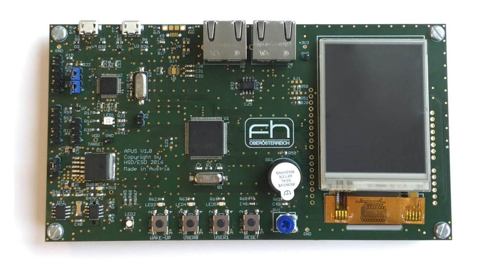
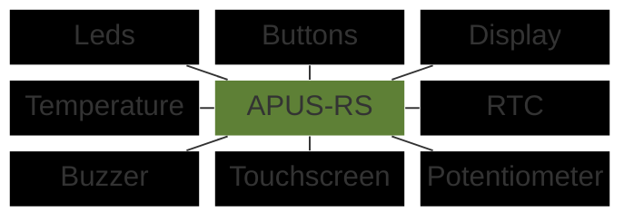

# apus-rs

Rust board-support crate for the **APUS board** — a development board built around the
STM32F072VBT6 (Arm Cortex-M0, 128 KB flash / 16 KB RAM).

[](https://github.com/jakobjung10/apus-rs/actions/workflows/ci.yml)



## Peripherals



## Quick start

```rust
#![no_std]
#![no_main]

use apus_rs::board::Board;
use apus_rs::prelude::*;
use cortex_m_rt::entry;
use panic_halt as _;
use stm32f0xx_hal::pac;

#[entry]
fn main() -> ! {
    let p = pac::Peripherals::take().unwrap();
    let mut board = Board::new(p);

    loop {
        board.leds.led3.on();
        board.delay.delay_ms(500);
        board.leds.led3.off();
        board.delay.delay_ms(500);
    }
}
```

## Examples

The [examples/](examples/) directory has a standalone demo per peripheral plus a combined
`full_demo`. Flash and run any of them by name:

```bash
cargo run --example leds
```

## Project layout

| Path | Contents |
|------|----------|
| [src/board.rs](src/board.rs) | the `Board` type that brings up all peripherals |
| [src/bsp/](src/bsp/) | per-peripheral drivers (leds, buttons, display, touch, …) |
| [src/peripherals/](src/peripherals/) | lower-level bus/peripheral setup (i2c, spi, adc) |
| [examples/](examples/) | runnable per-peripheral demos |

## Setup

See [docs/setup.md](docs/setup.md) for the toolchain setup.

## License

Licensed under either of

- Apache License, Version 2.0 ([LICENSE-APACHE](LICENSE-APACHE) or <http://www.apache.org/licenses/LICENSE-2.0>)
- MIT license ([LICENSE-MIT](LICENSE-MIT) or <http://opensource.org/licenses/MIT>)

at your option.

### Contribution

Unless you explicitly state otherwise, any contribution intentionally submitted
for inclusion in the work by you, as defined in the Apache-2.0 license, shall be
dual licensed as above, without any additional terms or conditions.
