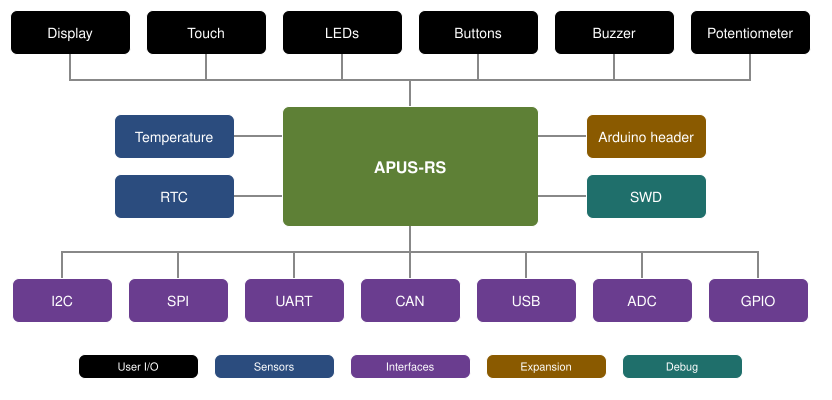

# apus-rs

Rust board-support crate for the **APUS board** — a development board built around the
STM32F072VBT6 (Arm Cortex-M0, 128 KB flash / 16 KB RAM).

[](https://github.com/apus-org/apus-rs/actions/workflows/ci.yml)


## Overview



| Subsystem | Part | Interface | Code | Examples |
|-----------|------|-----------|------|----------|
| Display | ST7789, 240×320 | 8080 parallel | [bsp/display](src/bsp/display/) | [display](examples/display.rs) |
| Touch | TSC2046 | SPI | [bsp/touch](src/bsp/touch/) | [touch_paint](examples/touch_paint.rs), [touch_theremin](examples/touch_theremin.rs), [touch_calibrate_store](examples/touch_calibrate_store.rs), [touch_calibrate_restore](examples/touch_calibrate_restore.rs) |
| LEDs | LED3–LED5, RGB LED | GPIO, PWM | [bsp/leds](src/bsp/leds/) | [leds](examples/leds.rs), [led_rgb](examples/led_rgb.rs) |
| Buttons | wake-up, user 0, user 1 | GPIO | [bsp/buttons](src/bsp/buttons/) | [buttons](examples/buttons.rs) |
| Buzzer | buzzer | GPIO | [bsp/buzzer](src/bsp/buzzer/) | [buzzer](examples/buzzer.rs) |
| Potentiometer | potentiometer | ADC | [bsp/potentiometer](src/bsp/potentiometer/) | [potentiometer](examples/potentiometer.rs) |
| Temperature | MCP9803 | I2C | [bsp/temperature](src/bsp/temperature/) | [temperature](examples/temperature.rs) |
| RTC | MCP79410 | I2C | [bsp/rtc](src/bsp/rtc/) | [rtc](examples/rtc.rs) |
| VCOM | FTDI USB-UART | UART | [bsp/vcom](src/bsp/vcom/) | [vcom_echo](examples/vcom_echo.rs) |
| UART | UART connector | UART | [peripherals/serial](src/peripherals/serial/) | [uart_echo](examples/uart_echo.rs) |
| CAN | SN65HVD230 | CAN | [peripherals/can](src/peripherals/can/) | [can_loopback](examples/can_loopback.rs) |
| USB | USB device | USB | [peripherals/usb](src/peripherals/usb/) | [usb_serial](examples/usb_serial.rs), [usb_trackpad](examples/usb_trackpad.rs) |
| SWD | debug port | SWD | [peripherals/swd](src/peripherals/swd/) | – |
| Arduino header | shields | SPI, UART, ADC, DAC, GPIO | [board/resources.rs](src/board/resources.rs) | [header_spi_loopback](examples/header_spi_loopback.rs), [header_uart_echo](examples/header_uart_echo.rs), [header_dac_adc](examples/header_dac_adc.rs), [shield_ethernet_udp_echo](examples/shield_ethernet_udp_echo.rs), [shield_ethernet_sd_card](examples/shield_ethernet_sd_card.rs) |

## Quick start

Generate a project from the [template](template/) and run it:

```bash
cargo install cargo-generate
cargo generate --git https://github.com/apus-org/apus-rs template --name my-app
cd my-app
cargo run --release
```

The generated `src/main.rs` blinks LED3:

```rust
#![no_std]
#![no_main]

use cortex_m_rt::entry;
use defmt_rtt as _;
use panic_probe as _;

use apus::board::Board;
use apus::hal::pac;
use apus::prelude::*;

#[entry]
fn main() -> ! {
    defmt::info!("my-app");

    let p = pac::Peripherals::take().unwrap();
    let mut board = Board::new(p);

    loop {
        board.leds.led3.on();
        board.delay.delay_ms(500);
        board.leds.led3.off();
        board.delay.delay_ms(500);
    }
}
```

## Examples

The [examples/](examples/) directory has a standalone demo per peripheral plus a combined
`full_demo`. Flash and run any of them by name:

```bash
cargo run --example leds
```

## Project layout

| Path | Contents |
|------|----------|
| [src/](src/) | source code |
| [examples/](examples/) | runnable demos per subsystem |
| [template/](template/) | project template for `cargo generate` |
| [docs/](docs/) | documentation |
| [device/](device/) | device description |

## Setup

See [docs/setup.md](docs/setup.md) for the toolchain setup.

## License

Licensed under either of

- Apache License, Version 2.0 ([LICENSE-APACHE](LICENSE-APACHE) or <http://www.apache.org/licenses/LICENSE-2.0>)
- MIT license ([LICENSE-MIT](LICENSE-MIT) or <http://opensource.org/licenses/MIT>)

at your option.

### Contribution

Unless you explicitly state otherwise, any contribution intentionally submitted
for inclusion in the work by you, as defined in the Apache-2.0 license, shall be
dual licensed as above, without any additional terms or conditions.
